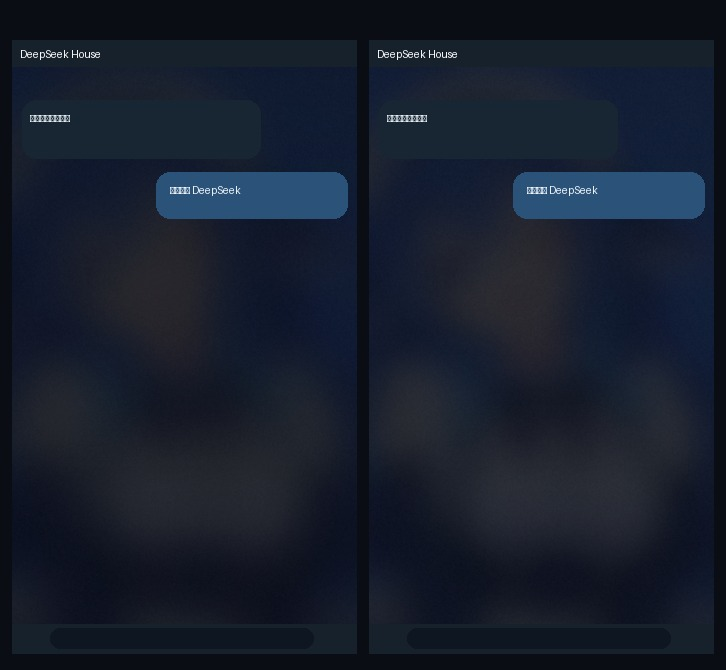

# DeepSeek House

仿 Telegram 风格的 **DeepSeek 安卓客户端**（第三方）。纯 WebView + 原生桥接实现，支持 **API Key / Token 登录**、**流式对话**、**推理过程展示**，以及**可自由安装的插件系统**。

> 非官方项目，与 DeepSeek 官方无关。API Key 仅保存在本机，直接与 `api.deepseek.com` 通信。

<p align="center">
  
</p>

## ✨ 功能

- **多会话聊天**：会话列表抽屉、置顶、重命名、删除、搜索、导出 Markdown
- **流式输出**：SSE 逐 token 渲染，可随时停止；停止后保留已生成内容
- **推理模型**：`deepseek-reasoner` 的思考过程折叠展示
- **Telegram 式界面**：会话列表为首屏（头像 / 最后消息 / 时间 / 置顶分组）、右下角 FAB 新建对话、
  对话页从右侧推入；气泡尾巴与连续消息分组、时间与已读双勾、输入栏附件/表情/实心发送钮、
  表情面板、Android 水波纹、顶栏滚动阴影、220ms 抽屉动画
- **聊天壁纸**：由作者相册第一张照片重度模糊衍生的深蓝抽象壁纸（`scripts/make_wallpaper.py` 可复现）
- **Markdown**：代码块（语言标签 + 一键复制）、表格、引用、列表、链接
- **插件系统**：内置计算器 / 时间 / 网页抓取 / 提示词模板；支持安装任意 `.js` 插件，
  插件可注册**斜杠命令**与**模型工具**（function calling），模型可自动调用插件
- **登录与设置**：API Key、自定义 Base URL（兼容自建/中转 endpoint）、模型、温度、最大 token、系统提示词
- **零依赖前端**：无 CDN、无外部字体图片，离线可用

## 📦 安装

1. 从 [Releases](../../releases) 下载 `DeepSeekHouse-1.0.6.apk`
2. 手机允许「安装未知来源应用」后安装
3. 打开 App → 填入 DeepSeek API Key（[platform.deepseek.com](https://platform.deepseek.com/api_keys)）→ 开始使用

也可以自行从源码构建（见下）。签名密钥随仓库提供（`keystore/dsh-release.keystore`，密码 `deepseekhouse`），
因此所有构建产物的签名一致，可直接覆盖升级。

## 🛠 构建

本项目**不使用 Gradle**，使用 Android SDK 的原始工具链（`aapt → javac → d8 → zipalign → apksigner`），
因此可以在 **Termux（手机端）** 或任何装了 Android SDK 的机器上构建。

```bash
# Termux（需要：openjdk-17 aapt d8 apksigner zipalign python3）
ANDROID_JAR=/path/to/android.jar bash scripts/build.sh

# Linux / CI（已安装 SDK，ANDROID_HOME 指向 SDK）
ANDROID_HOME=$ANDROID_HOME bash scripts/build.sh
```

产物：`dist/DeepSeekHouse-1.0.6.apk`

### 云端构建（GitHub Actions）

推 tag 或手动触发 `Build & Release APK` workflow 即可：

```bash
git tag v1.0.6 && git push origin v1.0.6
```

CI 会自动：静态契约检查 → JS 语法/冒烟测试 → 构建 APK → `apksigner verify` → 上传 artifact →
创建 Release 并附上 APK 与 SHA256。手机上直接从 Release 下载安装即可。

## 🧩 插件

应用内「插件」页 → 安装 → 粘贴代码或选择 `.js` 文件。插件可以：

- 注册斜杠命令（如 `/calc 2+3*4`）
- 注册模型工具（function calling，模型会自己决定何时调用）
- 订阅发送/响应钩子

开发文档见 [docs/PLUGINS.md](docs/PLUGINS.md)，示例见 [docs/examples/example-plugin.js](docs/examples/example-plugin.js)。

```js
DSPlugins.register({
  id: "user.hello", name: "打招呼", version: "1.0.0",
  builtin: false, description: "示例插件",
  commands: [{ name: "hello", description: "打个招呼",
    run: async (ctx, args) => `你好，${args || "世界"}！` }],
});
```

## 🏗 项目结构

```
app/
  AndroidManifest.xml
  src/main/java/com/deepseekhouse/app/   # MainActivity / JsBridge / ApiClient / PluginStore / Prefs
  res/                                    # 图标、颜色、主题、字符串
  assets/web/                             # 全部 UI（HTML/CSS/JS，WebView 加载）
    index.html  css/  js/{app,ui,bridge,store,api,markdown,util,plugins,plugins_builtin}.js
scripts/
  build.sh          # 打包流水线
  make_icons.py     # 从照片生成各分辨率图标
  check-assets.sh   # 资产/契约静态检查
  qa/               # jsdom 冒烟测试
docs/               # 插件文档、QA 文档
```

## 🖼 界面预览

<p align="center">
  
</p>

## 💧 水印 / 署名

应用内多处以 **@惜白.** 作为水印署名：聊天界面右下角、登录页、侧边栏底部、设置「关于」、导出的 Markdown 结尾。
本项目由 **@惜白.**（GitHub: [yzxcrush](https://github.com/yzxcrush)）定制并完全开源。

## 🔒 隐私与安全

- API Key 仅存储在本机 `SharedPreferences`，仅用于请求 `Authorization: Bearer` 头，不写日志、不上传
- 会话数据保存在应用私有目录（localStorage），不离开设备
- 插件为用户主动安装的本地 JS，**只安装可信来源的插件**；插件网络请求默认仅允许 `https`
- 仓库内的签名密钥仅用于本应用的个人构建（公开仓库中一并开源，便于任何人复现同签名构建）；
  它**不是秘密**，只用于保证本项目的版本可覆盖升级，请勿复用到其它应用
- 若你自行 fork 并发布，请务必重新生成自己的签名密钥（见 `scripts/build.sh`）

## 📄 License

MIT — 见 [LICENSE](LICENSE)。由 **@惜白.** 定制。
图标素材来自作者本人提供的照片，仅用于本应用图标。
